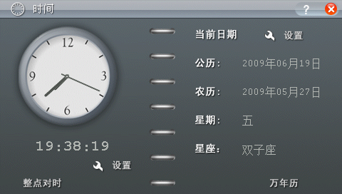

# BBK H1 Debug

步步高 **H1 / Y100 V1.41** 的后台USB调试器。第一次打开“H1调试”启动后台，
退出到桌面后仍可控制其他BDA；再次打开关闭调试。

支持按键与单点触摸、480×272原尺寸无损截图、RAM读写、原生测试模块执行、
完整BDA上传/替换、桌面刷新与运行，以及文件和目录管理。普通BDA更新可全程保持USB连接。

v1.0.3预览版补齐带线启动、ESP32 USB1/USB2调试桥和921600高速串口工具。
原有直连USB命令、CPU调频软件恢复和文件事务继续可用；本轮真机验收范围为ESP桥接与文件传输，
不把旧版本的完整硬件结论移用到新SHA。详见[本版说明](docs/release-v1.0.3.md)。

## 快速开始

从 [Releases](https://github.com/HelloClyde/BBKH1-debug/releases) 下载
`H1Debug.bda` 或 `H1Debug-install.zip`，复制到H1内置磁盘的
`应用/程序/H1Debug.bda`。安全弹出并拔线，打开“H1调试”、关闭启动提示，
再接USB。若替换已经运行过的旧调试器，先重启H1。详见 [安装说明](INSTALL.md)。

电脑取得仓库后安装PC依赖：

```powershell
git clone --recurse-submodules https://github.com/HelloClyde/BBKH1-debug.git
cd BBKH1-debug
python -m pip install -r requirements-client.txt
python tools/h1_debug.py list
python tools/h1_debug.py screenshot build/screen.png
python tools/h1_debug.py tap 106 52
python tools/h1_debug.py press ESCAPE --ticks 8
python tools/h1_debug.py --report build/usb-diag.json usb-diag
```

退出目标程序、回到空闲网格桌面后，可一条命令更新并运行完整BDA：

```powershell
python tools/h1_debug.py deploy dist/MyApp.bda 'A:\应用\程序\MyApp.bda'
python tools/h1_debug.py file list 'A:\应用\程序'
python tools/h1_debug.py file put build/data.bin 'A:\data.bin'
python tools/h1_debug.py file rename 'A:\data.bin' 'A:\renamed.bin'
python tools/h1_debug.py file delete 'A:\renamed.bin'
python tools/h1_debug.py desktop refresh
```

`file put`支持覆盖已有文件，也可用`get/stat/mkdir/rmdir`；`rmdir`仅删除空目录。
上传经过CRC重读和替换校验。`deploy --no-run`上传并刷新但不运行。
更新调试器自身的磁盘BDA后仍须重启，不能替换已经驻留的代码。
完整命令和边界见 [使用手册](h1-debug/README.md) 与 [协议](h1-debug/protocol.md)。

## ESP32桥接（不用来回换H1数据线）

ESP USB1通过数据软OTG接H1，USB2接电脑。H1回到空闲桌面后启动“H1调试”；
若系统问是否连接USB，选择否。USB2是CH340串口，先确认实际枚举端口，不能用H1旧COM4代替。
ESP通用固件0.4.5及源码见[H1 SDK](https://github.com/HelloClyde/bbk-h1-bda-sdk/tree/0b1e907a64f84f4f964b4dc6f5dc61e1dc60c05c/sdk/esp32)。

```powershell
python tools/h1_debug.py --port esp://COM6 status
python tools/h1_debug.py --port esp://COM6 file put build/data.bin 'A:\data.bin'
python tools/benchmark_h1_debug_files.py --port esp://COM6 --output build/speed --size 32768 --repeat 2
```

新工具只用只读INFO自动探测921600/115200，兼容旧ESP固件。H1Debug命令仍按序号/CRC串行确认，
不会并发重发文件写入或提交。Bridge只转发字节，不替代H1的USB独占关系。
本轮相同32KiB文件：新建上传8.0→3.4秒，覆盖8.3→5.3秒，下载6.5→约1.7秒；
全部校验通过、临时文件清理。提速来自ESP固件和电脑工具，H1的CDC波特率字段不代表USB真实线速。

## Codex skill

配套 [h1-debug skill](skills/h1-debug/SKILL.md) 随仓库发布，也提供独立
`h1-debug-skill.zip`。把其中的 `h1-debug` 目录复制到
`$CODEX_HOME/skills/`；未设置时使用用户目录下的 `.codex/skills/`。
已有同名skill时先保留自定义改动，再更新。

skill需要这份仓库及PC依赖；单独安装skill不会安装调试器或工具链。
使用时向Codex说明仓库位置，调用 `$h1-debug`。完整源码包也包含skill。

## 截图

以下为v1.0.2调频恢复验收的真机480×272原尺寸截图：

|软件恢复后前台BDA继续运行|退出测试BDA后返回桌面|
|---|---|
|||

以下为2026-10-17文件部署版的历史真机截图：

|刷新桌面显示V2名称|实际运行V2完整BDA|
|---|---|
|||



## 依赖与构建

- 成品：H1/Y100 **V1.41**；PC使用Python 3.10+、pyserial、Pillow。
- 构建环境：Windows、Python 3.12（CI）/3.11.5（本地已验证）、GNU MIPS
  `mipsel-none-elf-gcc` **15.2.0**、Pillow 12.3.0、pyelftools 0.33。
  Unicorn 2.1.4用于离线MIPS模型测试。准确依赖固定在`requirements.txt`。
- SDK：[bbk-h1-bda-sdk](https://github.com/MrDefinition1999/bbk-h1-bda-sdk)，
  固定`067fe072477861dfc8949d7b1a55279fb92d2548`，位于`vendor/h1-sdk`。
- 工具链安装器核验完整ZIP的SHA256；当前构建器使用Windows `.exe`工具链。
  图标PNG和生成记录已收录，不依赖本机字体、ImageGen服务或私有固件。

```powershell
git submodule update --init vendor/h1-sdk
python -m pip install -r requirements.txt
python scripts/install_toolchain.py
python tools/build_h1_debug.py
python scripts/verify_build.py
```

输出为`dist/H1Debug.bda`、构建摘要及SHA256文件。也可用
`--toolchain PATH_TO_BIN`指定相同GCC工具链。发布源码ZIP包含SDK快照及Git bundle，
解压后先运行`python scripts/prepare_source_archive.py`恢复SDK元数据，再执行上面的
pip、工具链、构建命令；无需重新下载SDK。

## 验证

当前v1.0.2与2026-10-19已安装并测试的二进制逐字节相同：

```text
SHA256 bf2934e44ae4d3bdc191acb10f61ec7f3c8d5b866bb4d4f2042dd6479dc4d412
image_id 71a0983b
BDA 101,708 bytes / resident RAM 727,104 bytes
```

本版真机通过桌面及动画BDA内两轮384MHz短测试：每轮32次32KiB RAM校验无错、CPU校验一致，
恢复336MHz，失步后由软件重新枚举恢复。每轮执行命令仅发送一次，原驻留服务没有重启。
恢复后的前台动画、原尺寸截图、后台512字节专属RAM读写/恢复释放、代码替换与BSS执行、
ESC返回、测试文件清理及10次串口重开均通过。
详见 [本版诊断说明](docs/usb-diagnostics.md) 和 [本版真机证据](docs/evidence/h1-debug-clock-usb-hardware-20261019.json)。

完整BDA V1→V2更新、全部文件管理、再次运行自身关闭与普通U盘恢复的历史物理验收，
属于`4214dbc1…bd8b3d`构建，见 [历史验收](docs/h1-debug.md)。本SHA未重跑物理关闭/磁盘恢复
与完整固件模拟器；相关模型回归通过，验证标记按实际范围保留。

公开CI执行156项主机、编译MIPS USB、传输及验收工具的离线测试和2个独立GNU重定位比较，
并从实际源码ZIP离线恢复SDK、重建和核对发布哈希。
它不连接真机、不运行私有固件；硬件验证通过精确二进制匹配绑定已有记录。
更多本地、私有固件及真机测试步骤见 [测试说明](tests/README.md)。

EXEC没有内存隔离或强制抢占，测试代码应正常返回或协作检查取消。
当前只验证上述固件；文件替换不承诺断电原子性。关闭时保留驻留分配供同版复用，重启回收。

## 感谢与许可

感谢 MrDefinition1999 和 H1 Native BDA SDK 贡献者提供SDK、格式与固件接口研究，
感谢GNU工具链、Python、Pillow、pyserial、pyelftools、Unicorn项目，
以及提供H1设备和完成实体步骤的测试者。

本独立项目的原创代码与skill使用 **GPL-3.0-only**，SDK保持 **Apache-2.0**。
具体来源、图标与截图权益说明见 [NOTICE](NOTICE.md)。仓库不分发BBK固件、NAND或原机应用转储。
