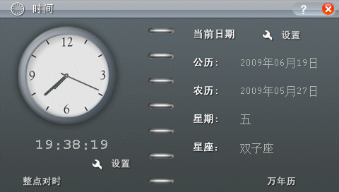

# BBK H1 Debug

步步高 **H1 / Y100 V1.41** 的后台USB调试器。第一次打开“H1调试”启动后台，
退出到桌面后仍可控制其他BDA；再次打开关闭调试。

支持按键与单点触摸、480×272原尺寸无损截图、RAM读写、原生测试模块执行、
完整BDA上传/替换、桌面刷新与运行，以及文件和目录管理。普通BDA更新可全程保持USB连接。

## 快速开始

从 [Releases](https://github.com/HelloClyde/BBKH1-debug/releases) 下载
`H1Debug.bda` 或 `H1Debug-install.zip`，复制到H1内置磁盘的
`应用/程序/H1Debug.bda`。安全弹出并拔线，打开“H1调试”、关闭启动提示，
再接USB。若替换已经运行过的旧调试器，先重启H1。详见 [安装说明](INSTALL.md)。

电脑取得仓库后安装PC依赖：

```powershell
git clone --recurse-submodules https://github.com/HelloClyde/BBKH1-debug.git
cd BBKH1-debug
python -m pip install -r requirements-client.txt
python tools/h1_debug.py list
python tools/h1_debug.py screenshot build/screen.png
python tools/h1_debug.py tap 106 52
python tools/h1_debug.py press ESCAPE --ticks 8
```

退出目标程序、回到空闲网格桌面后，可一条命令更新并运行完整BDA：

```powershell
python tools/h1_debug.py deploy dist/MyApp.bda 'A:\应用\程序\MyApp.bda'
python tools/h1_debug.py file list 'A:\应用\程序'
python tools/h1_debug.py file put build/data.bin 'A:\data.bin'
python tools/h1_debug.py file rename 'A:\data.bin' 'A:\renamed.bin'
python tools/h1_debug.py file delete 'A:\renamed.bin'
python tools/h1_debug.py desktop refresh
```

`file put`支持覆盖已有文件，也可用`get/stat/mkdir/rmdir`；`rmdir`仅删除空目录。
上传经过CRC重读和替换校验。`deploy --no-run`上传并刷新但不运行。
更新调试器自身的磁盘BDA后仍须重启，不能替换已经驻留的代码。
完整命令和边界见 [使用手册](h1-debug/README.md) 与 [协议](h1-debug/protocol.md)。

## Codex skill

配套 [h1-debug skill](skills/h1-debug/SKILL.md) 随仓库发布，也提供独立
`h1-debug-skill.zip`。把其中的 `h1-debug` 目录复制到
`$CODEX_HOME/skills/`；未设置时使用用户目录下的 `.codex/skills/`。
已有同名skill时先保留自定义改动，再更新。

skill需要这份仓库及PC依赖；单独安装skill不会安装调试器或工具链。
使用时向Codex说明仓库位置，调用 `$h1-debug`。完整源码包也包含skill。

## 截图

以下均为真机480×272原尺寸截图：

|刷新桌面显示V2名称|实际运行V2完整BDA|
|---|---|
|||



## 依赖与构建

- 成品：H1/Y100 **V1.41**；PC使用Python 3.10+、pyserial、Pillow。
- 构建环境：Windows、Python 3.12（CI）/3.11.5（本地已验证）、GNU MIPS
  `mipsel-none-elf-gcc` **15.2.0**、Pillow 12.3.0、pyelftools 0.33。
  Unicorn 2.1.4用于离线MIPS模型测试。准确依赖固定在`requirements.txt`。
- SDK：[bbk-h1-bda-sdk](https://github.com/MrDefinition1999/bbk-h1-bda-sdk)，
  固定`067fe072477861dfc8949d7b1a55279fb92d2548`，位于`vendor/h1-sdk`。
- 工具链安装器核验完整ZIP的SHA256；当前构建器使用Windows `.exe`工具链。
  图标PNG和生成记录已收录，不依赖本机字体、ImageGen服务或私有固件。

```powershell
git submodule update --init vendor/h1-sdk
python -m pip install -r requirements.txt
python scripts/install_toolchain.py
python tools/build_h1_debug.py
python scripts/verify_build.py
```

输出为`dist/H1Debug.bda`、构建摘要及SHA256文件。也可用
`--toolchain PATH_TO_BIN`指定相同GCC工具链。发布源码ZIP包含SDK快照及Git bundle，
解压后先运行`python scripts/prepare_source_archive.py`恢复SDK元数据，再执行上面的
pip、工具链、构建命令；无需重新下载SDK。

## 验证

当前v1.0.1与已安装并测试的二进制逐字节相同；它修复v1.0.0源码ZIP的SDK bundle历史缺项，BDA和skill保持一致：

```text
SHA256 4214dbc11266c59359dac38d3ad6386c3d727e0f534a6520e952c5872cbd8b3d
image_id 7195598f
BDA 98,828 bytes / resident RAM 725,472 bytes
```

真机通过同一USB会话V1→V2完整更新、桌面名称刷新、实际运行、文件管理、
后台内存与代码执行、触摸/按键、原尺寸截图、10次串口重开、再次运行自身关闭及U盘恢复。
32KB测试BDA上传并提交校验约2.9～3.6秒；这不是任意文件的速度保证。
详见 [验收记录](docs/h1-debug.md) 和 [机器可读证据](docs/evidence/h1-debug-deploy-hardware-20261017.json)。

公开CI执行139项离线测试及2个独立GNU重定位比较，并从实际源码ZIP离线恢复SDK、重建和核对发布哈希。
它不连接真机、不运行私有固件；硬件验证通过精确二进制匹配绑定已有记录。
更多本地、私有固件及真机测试步骤见 [测试说明](tests/README.md)。

EXEC没有内存隔离或强制抢占，测试代码应正常返回或协作检查取消。
当前只验证上述固件；文件替换不承诺断电原子性。关闭时保留驻留分配供同版复用，重启回收。

## 感谢与许可

感谢 MrDefinition1999 和 H1 Native BDA SDK 贡献者提供SDK、格式与固件接口研究，
感谢GNU工具链、Python、Pillow、pyserial、pyelftools、Unicorn项目，
以及提供H1设备和完成实体步骤的测试者。

本独立项目的原创代码与skill使用 **GPL-3.0-only**，SDK保持 **Apache-2.0**。
具体来源、图标与截图权益说明见 [NOTICE](NOTICE.md)。仓库不分发BBK固件、NAND或原机应用转储。
